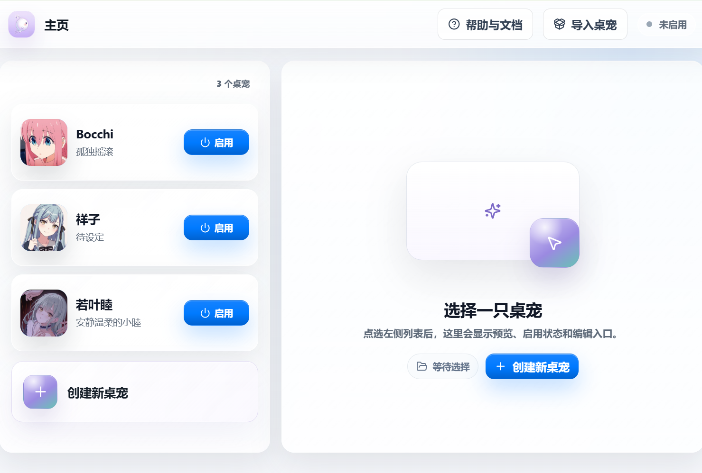

# 桌面灵  mac版 完全适合mac系统

简体中文


一款**开源、可自定义、本地优先的 Live2D 桌宠软件框架**。用户可以导入自己的 Live2D 模型，配置桌宠资料、人设、事件台词、AI 聊天，以及可选的视觉和语音能力。

> 桌面灵不内置受版权限制的角色模型、声音模型、参考音频、AI Key 或云服务密钥。开源版提供的是桌宠框架和配置工具，真实角色资源由用户自行导入并保存在本机。

**当前主要平台**：Windows mac

---

## 界面预览

> 截图来自本机演示配置。角色模型和其它用户资源不会随开源仓库发布。



---

## 功能概览

桌面灵的核心路径是“创建桌宠 → 导入模型 → 按需配置 → 启用使用”。每只桌宠的资料、模型和功能设置彼此独立。

- **模型与表现**：支持 Cubism 2/3/4/5 Live2D 文件夹导入、预览，以及动作、表情和事件映射。
- **聊天与视觉**：可连接 OpenAI-compatible 服务，使用普通聊天、主动截图识图或显式开启的屏幕观察。
- **本地记忆**：可选的记忆书按桌宠隔离，支持召回、自动整理和手动管理。
- **桌面交互**：透明窗口、聊天框、字幕、右键快捷菜单、拖拽和点击穿透。
- **可选语音**：腾讯云语音输入和本机 GPT-SoVITS 语音回复，未配置时不影响文字聊天。

## 用户使用

### 1. 从主页创建桌宠

启动应用进入主页，点击“创建新桌宠”。先在“基础信息”中填写名称，再按需要补充头像、简介、角色定位、性格描述和适合场景。头像支持 PNG、JPG、JPEG 和 WebP，选择后可以在裁剪窗口调整范围。

点击“保存”后，这只桌宠才会正式出现在主页列表中，后续的模型导入和功能配置也才有保存目标。主页还可以查看预览、进入编辑器、启用或关闭桌宠，以及删除本地桌宠。

编辑器的每个页面独立保存。切换页面或返回主页前，如果当前页面有未保存修改，应用会提示确认；确认离开会放弃这次尚未保存的修改。

### 2. 导入并检查 Live2D

进入当前桌宠的“Live2D”页面，选择完整模型文件夹，也可以把文件夹拖入导入区域，不要只选一个入口文件。当前支持：

- Cubism 2：`model.json` / `.moc`
- Cubism 3/4/5：`.model3.json` / `.moc3`

导入后应用会检查模型入口、Moc、贴图、动作和表情。通过检查后可以先预览模型，确认贴图完整、尺寸位置合适，并测试动作和表情；确认无误再点击“保存”。

保存完成后，页面会显示模型入口以及资源数量。动作和表情源也会被记录下来，供后面的表现映射和事件配置使用。模型资源会复制到本机桌宠数据目录，仓库不会保存你的真实模型。

### 3. 设置外观和常用操作

在“界面主题”中可以选择内置主题，也可以导入自定义主题。自定义主题先进入当前桌宠的未保存草稿，保存后才生效；切换内置主题不会自动删除已经导入的主题。

“快捷操作”适合在模型能正常运行后调整：

- 桌宠比例可在 70%–150% 之间以 5% 为步进调整，也可以恢复 100%。
- 点击穿透可以减少桌宠对其它窗口的遮挡；开启后聊天和其它交互会暂时关闭，解锁入口只在鼠标进入桌宠模型区域时显示，入口以外区域仍保持穿透，点击解锁后恢复。
- 鼠标光标跟随控制模型是否跟随光标转动视线，关闭后会回到中性方向，不影响拖动。

### 4. 配置 AI、人设和表现

在“AI 设置 / LLM 配置”中填写服务商、Base URL、API Key 和模型名。点击连接可以读取模型列表，无法读取时也可以手动填写模型名；保存或点击“测试输出”后，页面会显示当前模型能使用的输出能力。认证失败、限流或网络错误需要先解决，不能当作模型能力不足。

在“角色人设”中填写“我是谁”，说明桌宠的身份、性格、说话方式、称呼和互动边界，再选择文字输出语言和回复长度。角色专属内容应写在当前桌宠的人设中，而不是写进通用设置。

Live2D 导入完成后，进入“表现映射”给需要使用的动作或表情填写英文 key 和中文描述。key 需要以英文字母开头，只能使用英文、数字、下划线或短横线，且同一桌宠不能重复。描述越具体，越方便 AI 和事件配置理解该表现。

在“事件配置”中，可以为模型加载、点击、拖拽、打开或关闭聊天、点击穿透、长时间无操作等行为绑定动作、表情和候选台词。先保存表现映射，再到事件页选择资源；页面中的预览可以直接在桌宠窗口确认效果。

### 5. 按需开启视觉、语音和记忆

这些能力都是可选的，未配置时不影响模型展示；文字聊天需要先完成 AI 连接。

**视觉功能**需要当前聊天模型具备图片理解能力。先在视觉设置中测试模型，再选择主动截图聊天或持续观察。主动识图只在本次请求附上截图；持续观察必须由用户主动开启，并在停止后释放屏幕捕获资源。

**语音输入**在“语音系统 / 语音输入”中配置腾讯云实时语音识别。填写 AppID、SecretId 和 SecretKey 后连接，再调整自动结束、静音时长、音量阈值和是否连续录音。使用时必须点击聊天框的麦克风按钮，软件不会后台监听或无提示录音。

**语音回复**在“语音系统 / 声音模型”中配置本机 GPT-SoVITS，选择匹配的模型版本、GPT/SoVITS 模型和推理设备，并提供本机可读取的 3–10 秒参考音频与参考文本。连接成功后再选择输出语言和播放方式；语音失败不会影响文字聊天和字幕。

**记忆书**按桌宠单独保存。第一次进入时可以确认启用召回和自动整理，默认不保留原始来源；选择暂不启用只关闭本次引导，下次进入仍可重新选择。记忆书支持章节阅读、搜索、时间筛选、编辑、忘记、撤销和导出。只有明确启用自动整理后，当前用户消息和最终可见回复才会发送给配置的整理 AI。

### 6. 启用并使用桌宠

回到主页，选择已经导入模型的桌宠并点击“启用桌宠”。桌宠会以透明无边框窗口运行。

- 右键模型区域打开圆形快捷菜单，再进入聊天、心情或其它操作。
- 开启“触控”后可以拖动桌宠；开启“穿透”后桌宠尽量不挡住其它窗口，鼠标进入模型区域才会显示可点击的“解锁”入口。
- 聊天框可以进行普通文字聊天；如果配置了语音输入，可以从麦克风按钮主动录音。
- 关闭桌宠只会关闭运行窗口，不会删除配置；之后可以从主页或托盘重新启用。

### 7. 导入、导出与备份

主页的“导入桌宠”用于安装 `.zmling` 桌宠包。应用会先检查包结构和资源，再在隔离目录中安装；检查失败或取消不会留下半成品。如果桌宠包包含 AI 配置，导入时需要使用自己的 AI Key；包不会带入原作者的连接凭据、腾讯云凭据、记忆或桌面运行状态。

在已保存且没有未保存修改的桌宠编辑器中，可以使用“导出桌宠”制作分享或备份包。导出前请确认自己拥有包内模型、贴图、声音模型和参考音频的复制与分发权。

---

## 安装与运行

### 从源码运行

前置要求：

- Node.js 18+
- npm 9+
- Windows 10 / 11

安装依赖：

```powershell
npm.cmd install
```

开发模式运行：

```powershell
npm.cmd run dev
```

类型检查和构建：

```powershell
npm.cmd run typecheck
npm.cmd run build
```

`npm.cmd run build` 会在构建末尾执行发布资源审计。开发机上的 `public/live2d/` 模型不会复制到 `dist/`；如果构建产物中出现 Live2D 模型、声音模型、参考音频或本地私密配置，构建会直接失败。

### 构建 Windows 安装包

```powershell
npm.cmd run prepare:memory-runtime
npm.cmd run dist:win
```

打包命令会组装受控的 Python 3.13 记忆运行时，并检查实际安装包中的资源边界。生成的安装包和免安装版位于：

```text
release/
```

不要手工把 `public/live2d/` 或 `userData/pets/` 复制到 `dist/` 或 `release/`。

### 预览生产构建

```powershell
npm.cmd run preview:prod
npm.cmd run start:prod
```

---

## 本地数据与隐私

桌面灵是本地优先的桌面软件。用户创建的桌宠、头像、Live2D 模型、AI 设置、人设、事件台词和语音配置默认保存在：

```text
%APPDATA%/zhuomianling/
```

每只桌宠的数据通常位于 `pets/<pet-id>/`。API Key 和腾讯云凭据由 Electron `safeStorage` 加密保存，普通配置只保留必要的状态或非敏感元数据。只有用户明确开启记忆自动整理时，当前用户消息和最终可见回复才会发送给用户配置的整理 AI；中文记忆检索在本机完成。

请不要把 `.env`、`*.local.json`、真实密钥、本机绝对路径、未授权 Live2D 模型、声音模型或参考音频提交到仓库。更换电脑或重装系统前，请自行备份需要保留的本地桌宠数据。

---

## 开源版不包含

- 受版权限制的 Live2D 模型、贴图、动作或角色图片
- 内置商业、动漫或游戏角色配置
- API Key、Token、腾讯云密钥或其它 AI 服务密钥
- GPT-SoVITS 声音模型、参考音频、`.pth`、`.ckpt` 或生成音频
- 云端 AI 服务或托管后端

正式 Windows 包可以携带通用的本地中文记忆运行时和 BGE INT8 模型，但不包含任何用户记忆、预置角色记忆或用户导入资源。

---

## 文档

- [用户使用指南](docs/用户使用指南.md)
- [资源与隐私边界](docs/资源与隐私边界.md)
- [AI 输出兼容性基线](docs/人工智能输出兼容性基线.md)
- [Windows 打包与 GitHub 发布要求](桌面灵打包与GitHub发布要求.md)

---

## 技术栈

- [Electron](https://www.electronjs.org/)：桌面应用外壳
- [React](https://react.dev/)：渲染进程 UI
- [TypeScript](https://www.typescriptlang.org/)：类型系统
- [Vite](https://vite.dev/)：开发和构建
- [Live2D Cubism SDK](https://www.live2d.com/en/sdk/about/)：Live2D 模型运行时
- [lucide-react](https://lucide.dev/)：界面图标
- GPT-SoVITS：可选本地语音回复服务
- 腾讯云实时语音识别：可选语音输入服务

---

## 第三方运行时声明

本项目包含 Live2D runtime / Cubism SDK 相关文件，用于加载和驱动 Live2D 模型。这些文件不属于本项目原创代码。

使用、复制、分发或发布包含 Live2D runtime / Cubism SDK 文件的软件时，请遵守 Live2D 官方许可条款。详见 [NOTICE](NOTICE)。

---

## 许可证

本项目开源代码采用 [MIT License](LICENSE)。

Live2D runtime / Cubism SDK 相关文件遵循 Live2D 官方许可条款；用户导入的角色模型、声音模型、参考音频等资源由用户自行确认授权。

---

## 免责声明

本项目仅提供桌宠软件框架和本地配置工具。使用者需要自行确保导入的 Live2D 模型、角色图片、声音模型、参考音频、AI 服务和云服务配置拥有合法使用权。

项目作者不对用户自行导入、生成、配置或分发的第三方资源承担授权责任。
